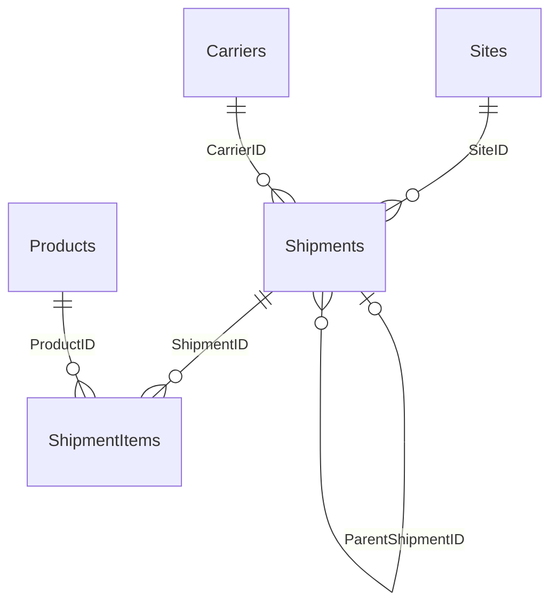

# Oil: connected SQL Server project

Track origin sites, carriers, shipments and product lines; compare and check shipment values and identify missing detail.

**Goal:** build and explain five related tables, prove that constraints protect data, safely change data and produce correct multi-table reports. There is no daily schedule. Advance after passing each checkpoint.

## 1. Understand the relationships

A primary key identifies one row. A foreign key stores the identity of a related parent row. The parent must exist before inserting a non-NULL child reference. A UNIQUE key protects another business identifier; CHECK enforces a row-level rule; NOT NULL makes a value required.

Every FK uses NO ACTION. Delete children before a referenced parent, or redesign the business workflow explicitly. Root events have a NULL parent-event ID. The self-FK verifies parent existence, while a separate CHECK rejects self-parenting; these rules do not prevent longer cycles.

## 2. Build the five tables

Start in a new disposable SQL Server 2017+ database. Work in this order: **Sites → Carriers → Products → Shipments → ShipmentItems**. Use the DDL Create assignments linked below. Do not run the complete setup first if you are practicing CREATE.

### Sites

**Sites** — Origin sites dispatch many shipments.

| Column | Type | Requirement |
|---|---|---|
| SiteID | int | NOT NULL |
| SiteName | nvarchar(80) | NOT NULL |
| SiteCode | varchar(20) | NOT NULL |
| Region | varchar(10) | NOT NULL |

Primary key: **SiteID**.
Unique business key: **SiteCode**.
Business rule: `LEN(LTRIM(RTRIM(SiteName))) > 0`.

### Carriers

**Carriers** — Each shipment is assigned to one carrier.

| Column | Type | Requirement |
|---|---|---|
| CarrierID | int | NOT NULL |
| CarrierName | nvarchar(80) | NOT NULL |
| CarrierCode | varchar(20) | NOT NULL |
| Active | bit | NOT NULL DEFAULT (1) |

Primary key: **CarrierID**.
Unique business key: **CarrierCode**.
Business rule: `LEN(LTRIM(RTRIM(CarrierName))) > 0`.

### Products

**Products** — Product catalog; shipment lines retain historical unit prices.

| Column | Type | Requirement |
|---|---|---|
| ProductID | int | NOT NULL |
| ProductName | nvarchar(80) | NOT NULL |
| ProductCode | varchar(20) | NOT NULL |
| PricePerUnit | decimal(12,2) | NOT NULL |

Primary key: **ProductID**.
Unique business key: **ProductCode**.
Business rule: `PricePerUnit >= 0`.
Business rule: `LEN(LTRIM(RTRIM(ProductName))) > 0`.

### Shipments

**Shipments** — The main business event; linked to its master and optionally to a related earlier event. The parent link is for teaching hierarchy traversal, not a guarantee of an acyclic graph.

| Column | Type | Requirement |
|---|---|---|
| ShipmentID | int | NOT NULL |
| SiteID | int | NOT NULL |
| ShipmentReference | nvarchar(80) | NOT NULL |
| ShipmentType | varchar(10) | NOT NULL |
| Status | varchar(10) | NOT NULL DEFAULT ('Open') |
| ShipmentValue | decimal(12,2) | NULL |
| UnitCount | int | NOT NULL |
| ShipDate | date | NOT NULL |
| DispatchedAt | datetime2(3) | NOT NULL |
| RecordedAt | datetimeoffset(3) | NOT NULL |
| Note | nvarchar(100) | NULL |
| BackupNote | nvarchar(100) | NULL |
| ParentShipmentID | int | NULL |
| CarrierID | int | NOT NULL |

Primary key: **ShipmentID**.
Unique business key: **ShipmentReference**.
Business rule: `ShipmentType IN ('A','B','C')`.
Business rule: `Status IN ('Open','Closed','Pending')`.
Business rule: `ShipmentValue >= 0`.
Business rule: `UnitCount > 0`.
Business rule: `ParentShipmentID IS NULL OR ParentShipmentID <> ShipmentID`.
Business rule: `LEN(LTRIM(RTRIM(ShipmentReference))) > 0`.
Foreign key: **Shipments.SiteID → Sites.SiteID**. Use NO ACTION on delete/update; do not disable checking.
Foreign key: **Shipments.ParentShipmentID → Shipments.ShipmentID**. Use NO ACTION on delete/update; do not disable checking.
Foreign key: **Shipments.CarrierID → Carriers.CarrierID**. Use NO ACTION on delete/update; do not disable checking.

### ShipmentItems

**ShipmentItems** — Bridge between shipments and oil products; one row per shipment/product combination.

| Column | Type | Requirement |
|---|---|---|
| ShipmentItemID | int | NOT NULL |
| ShipmentID | int | NOT NULL |
| ProductID | int | NOT NULL |
| Quantity | int | NOT NULL |
| PricePerUnit | decimal(12,2) | NOT NULL |

Primary key: **ShipmentItemID**.
Unique business key: **ShipmentID, ProductID**.
Business rule: `Quantity > 0`.
Business rule: `PricePerUnit >= 0`.
Foreign key: **ShipmentItems.ShipmentID → Shipments.ShipmentID**. Use NO ACTION on delete/update; do not disable checking.
Foreign key: **ShipmentItems.ProductID → Products.ProductID**. Use NO ACTION on delete/update; do not disable checking.

**Checkpoint:** five tables exist; each has a PK; every specified FK is enabled and trusted. Explain the one-to-many relationships and the purpose of any composite UNIQUE key without reading the solution.

## 3. Load and inspect sample data

Use the Data Setup insert exercises in the same parent-before-child order. Use the sample rows below. Ask your instructor for help loading them if needed. Add them only once.

The main event table contains training codes A/B/C and statuses Open/Closed/Pending, not a full production workflow. Its reference strings deliberately include case and whitespace for cleaning exercises. Monetary totals are recorded event values; line details exist only for selected events to support missing-detail and reconciliation reports. NULL means unknown, not zero.

### Sample rows: Sites

| SiteID | SiteName | SiteCode | Region |
|---|---|---|---|
| `1` | `Sites Alpha` | `SIT-1` | `North` |
| `2` | `Sites Beta` | `SIT-2` | `South` |
| `3` | `Sites Gamma` | `SIT-3` | `North` |
| `4` | `Sites Delta` | `SIT-4` | `West` |
| `5` | `Sites Unused` | `SIT-5` | `East` |

### Sample rows: Carriers

| CarrierID | CarrierName | CarrierCode | Active |
|---|---|---|---|
| `1` | `Carrier 1` | `CR-1` | `1` |
| `2` | `Carrier 2` | `CR-2` | `1` |
| `3` | `Carrier 3` | `CR-3` | `1` |
| `4` | `Carrier 4` | `CR-4` | `1` |
| `5` | `Carrier 5` | `CR-5` | `0` |

### Sample rows: Products

| ProductID | ProductName | ProductCode | PricePerUnit |
|---|---|---|---|
| `1` | `Grade 1` | `OIL-1` | `20` |
| `2` | `Grade 2` | `OIL-2` | `40` |
| `3` | `Grade 3` | `OIL-3` | `60` |
| `4` | `Grade 4` | `OIL-4` | `80` |
| `5` | `Grade 5` | `OIL-5` | `100` |

### Sample rows: Shipments

| ShipmentID | SiteID | ShipmentReference | ShipmentType | Status | ShipmentValue | UnitCount | ShipDate | DispatchedAt | RecordedAt | Note | BackupNote | ParentShipmentID | CarrierID |
|---|---|---|---|---|---|---|---|---|---|---|---|---|---|
| `1` | `1` | `  Alpha-One  ` | `A` | `Open` | `100` | `1` | `20240101` | `2024-01-01T12:30:45.123` | `2024-01-01T12:30:45.123+00:00` | NULL | `backup` | NULL | `1` |
| `2` | `1` | `beta-Two` | `B` | `Closed` | `200` | `2` | `20240102` | `2024-01-02T12:30:45.123` | `2024-01-02T12:30:45.123+00:00` | `confirmed` | NULL | `1` | `2` |
| `3` | `2` | `Gamma-Three ` | `C` | `Pending` | `200` | `3` | `20240102` | `2024-01-02T12:30:45.123` | `2024-01-02T12:30:45.123+00:00` | `confirmed` | `backup` | `1` | `3` |
| `4` | `2` | ` Delta-Four` | `A` | `Open` | NULL | `4` | `20240103` | `2024-01-03T12:30:45.123` | `2024-01-03T12:30:45.123+00:00` | NULL | NULL | `2` | `4` |
| `5` | `3` | `Echo-Five` | `B` | `Closed` | `50` | `1` | `20240201` | `2024-02-01T12:30:45.123` | `2024-02-01T12:30:45.123+00:00` | `confirmed` | `backup` | `2` | `1` |
| `6` | `3` | `ALPHA-Six` | `C` | `Pending` | `300` | `2` | `20240210` | `2024-02-10T12:30:45.123` | `2024-02-10T12:30:45.123+00:00` | `confirmed` | NULL | `3` | `2` |
| `7` | `4` | `Zero-Seven` | `A` | `Open` | `0` | `3` | `20240229` | `2024-02-29T12:30:45.123` | `2024-02-29T12:30:45.123+00:00` | NULL | `backup` | `3` | `3` |
| `8` | `4` | `Review-Eight` | `B` | `Closed` | `150` | `4` | `20240301` | `2024-03-01T12:30:45.123` | `2024-03-01T12:30:45.123+00:00` | `confirmed` | NULL | `4` | `4` |
| `9` | `4` | `Zulu-Nine` | `C` | `Pending` | `300` | `1` | `20240310` | `2024-03-10T12:30:45.123` | `2024-03-10T12:30:45.123+00:00` | `confirmed` | `backup` | `4` | `1` |
| `10` | `4` | `Iota-Ten` | `A` | `Open` | `80` | `2` | `20241103` | `2024-11-03T12:30:45.123` | `2024-11-03T12:30:45.123+00:00` | NULL | NULL | `5` | `2` |
| `11` | `1` | `Kappa-Eleven` | `B` | `Closed` | `120` | `3` | `20241231` | `2024-12-31T12:30:45.123` | `2024-12-31T12:30:45.123+00:00` | `confirmed` | `backup` | `5` | `3` |
| `12` | `2` | `Last-Twelve` | `C` | `Pending` | `200` | `4` | `20250101` | `2025-01-01T12:30:45.123` | `2025-01-01T12:30:45.123+00:00` | `confirmed` | NULL | `6` | `4` |

### Sample rows: ShipmentItems

| ShipmentItemID | ShipmentID | ProductID | Quantity | PricePerUnit |
|---|---|---|---|---|
| `1` | `1` | `1` | `3` | `20` |
| `2` | `1` | `2` | `1` | `40` |
| `3` | `2` | `2` | `5` | `40` |
| `4` | `3` | `1` | `10` | `20` |
| `5` | `6` | `3` | `5` | `60` |

**Checkpoint:** row counts match the samples, no FK references are missing, and known event amounts total **1700**. Master ID 5 has no events. All 12 events reference real masters; there are no deliberately invalid FK values.

## 4. Prove the rules and practice changes

Start each exercise with the original tables and sample rows in a practice database. Ask your instructor to reset the practice tables between exercises that change them. Show the results before and after. In exercises that test a rule, an error message is expected. Keep the rules turned on. See [the beginner guide](../../../SQL/Excerises/BEGINNER_GUIDE.md) if these terms are new.

## Assignment navigation

IDs are labels, not dates. Each row below links to questions for this domain only. Open [the student question index](README.md) to see all topics.

| Topic | Subtopic | Your assignment IDs |
|---|---|---|
| [DDL](DDL.md) | Create | DDL-01-05, DDL-01-10, DDL-01-15, DDL-01-20, DDL-01-25 |
| [DDL](DDL.md) | Alter | DDL-02-05, DDL-02-10, DDL-02-15, DDL-02-20, DDL-02-25 |
| [DDL](DDL.md) | Drop | DDL-03-05, DDL-03-10, DDL-03-15, DDL-03-20, DDL-03-25 |
| [DATA_SETUP](DATA_SETUP.md) | Create tables | DATA_SETUP-01-05, DATA_SETUP-01-10, DATA_SETUP-01-15, DATA_SETUP-01-20, DATA_SETUP-01-25 |
| [DATA_SETUP](DATA_SETUP.md) | Insert data into the tables | DATA_SETUP-02-05, DATA_SETUP-02-10, DATA_SETUP-02-15, DATA_SETUP-02-20, DATA_SETUP-02-25 |
| [CONSTRAINTS](CONSTRAINTS.md) | Not Null | CONSTRAINTS-01-05, CONSTRAINTS-01-10, CONSTRAINTS-01-15, CONSTRAINTS-01-20, CONSTRAINTS-01-25 |
| [CONSTRAINTS](CONSTRAINTS.md) | Unique | CONSTRAINTS-02-05, CONSTRAINTS-02-10, CONSTRAINTS-02-15, CONSTRAINTS-02-20, CONSTRAINTS-02-25 |
| [CONSTRAINTS](CONSTRAINTS.md) | Check | CONSTRAINTS-03-05, CONSTRAINTS-03-10, CONSTRAINTS-03-15, CONSTRAINTS-03-20, CONSTRAINTS-03-25 |
| [CONSTRAINTS](CONSTRAINTS.md) | Primary key | CONSTRAINTS-04-05, CONSTRAINTS-04-10, CONSTRAINTS-04-15, CONSTRAINTS-04-20, CONSTRAINTS-04-25 |
| [CONSTRAINTS](CONSTRAINTS.md) | Foreign key | CONSTRAINTS-05-05, CONSTRAINTS-05-10, CONSTRAINTS-05-15, CONSTRAINTS-05-20, CONSTRAINTS-05-25 |
| [DML](DML.md) | Insert | DML-01-05, DML-01-10, DML-01-15, DML-01-20, DML-01-25 |
| [DML](DML.md) | Update | DML-02-05, DML-02-10, DML-02-15, DML-02-20, DML-02-25 |
| [DML](DML.md) | Delete | DML-03-05, DML-03-10, DML-03-15, DML-03-20, DML-03-25 |
| [DQL](DQL.md) | Select | DQL-01-05, DQL-01-10, DQL-01-15, DQL-01-20, DQL-01-25 |
| [DQL](DQL.md) | Where | DQL-02-05, DQL-02-10, DQL-02-15, DQL-02-20, DQL-02-25 |
| [DQL](DQL.md) | Group By | DQL-03-05, DQL-03-10, DQL-03-15, DQL-03-20, DQL-03-25 |
| [DQL](DQL.md) | Having | DQL-04-05, DQL-04-10, DQL-04-15, DQL-04-20, DQL-04-25 |
| [DQL](DQL.md) | Order By | DQL-05-05, DQL-05-10, DQL-05-15, DQL-05-20, DQL-05-25 |
| [DQL](DQL.md) | Top | DQL-06-05, DQL-06-10, DQL-06-15, DQL-06-20, DQL-06-25 |
| [OPERATORS](OPERATORS.md) | Equality Operator (=) | OPERATORS-01-05, OPERATORS-01-10, OPERATORS-01-15, OPERATORS-01-20, OPERATORS-01-25 |
| [OPERATORS](OPERATORS.md) | Inequality Operator (<>) | OPERATORS-02-05, OPERATORS-02-10, OPERATORS-02-15, OPERATORS-02-20, OPERATORS-02-25 |
| [OPERATORS](OPERATORS.md) | Greater Than (>) | OPERATORS-03-05, OPERATORS-03-10, OPERATORS-03-15, OPERATORS-03-20, OPERATORS-03-25 |
| [OPERATORS](OPERATORS.md) | Greater Than or Equal To (>=) | OPERATORS-04-05, OPERATORS-04-10, OPERATORS-04-15, OPERATORS-04-20, OPERATORS-04-25 |
| [OPERATORS](OPERATORS.md) | Less Than (<) | OPERATORS-05-05, OPERATORS-05-10, OPERATORS-05-15, OPERATORS-05-20, OPERATORS-05-25 |
| [OPERATORS](OPERATORS.md) | Less Than or Equal To (<=) | OPERATORS-06-05, OPERATORS-06-10, OPERATORS-06-15, OPERATORS-06-20, OPERATORS-06-25 |
| [OPERATORS](OPERATORS.md) | IN Operator | OPERATORS-07-05, OPERATORS-07-10, OPERATORS-07-15, OPERATORS-07-20, OPERATORS-07-25 |
| [OPERATORS](OPERATORS.md) | NOT IN Operator | OPERATORS-08-05, OPERATORS-08-10, OPERATORS-08-15, OPERATORS-08-20, OPERATORS-08-25 |
| [OPERATORS](OPERATORS.md) | LIKE Operator | OPERATORS-09-05, OPERATORS-09-10, OPERATORS-09-15, OPERATORS-09-20, OPERATORS-09-25 |
| [OPERATORS](OPERATORS.md) | NOT LIKE Operator | OPERATORS-10-05, OPERATORS-10-10, OPERATORS-10-15, OPERATORS-10-20, OPERATORS-10-25 |
| [OPERATORS](OPERATORS.md) | BETWEEN Operator | OPERATORS-11-05, OPERATORS-11-10, OPERATORS-11-15, OPERATORS-11-20, OPERATORS-11-25 |
| [OPERATORS](OPERATORS.md) | EXISTS Operator | OPERATORS-12-05, OPERATORS-12-10, OPERATORS-12-15, OPERATORS-12-20, OPERATORS-12-25 |
| [OPERATORS](OPERATORS.md) | NOT EXISTS Operator | OPERATORS-13-05, OPERATORS-13-10, OPERATORS-13-15, OPERATORS-13-20, OPERATORS-13-25 |
| [JOINS](JOINS.md) | Inner Join | JOINS-01-05, JOINS-01-10, JOINS-01-15, JOINS-01-20, JOINS-01-25 |
| [JOINS](JOINS.md) | Left Join | JOINS-02-05, JOINS-02-10, JOINS-02-15, JOINS-02-20, JOINS-02-25 |
| [JOINS](JOINS.md) | Right Join | JOINS-03-05, JOINS-03-10, JOINS-03-15, JOINS-03-20, JOINS-03-25 |
| [JOINS](JOINS.md) | Full Join | JOINS-04-05, JOINS-04-10, JOINS-04-15, JOINS-04-20, JOINS-04-25 |
| [JOINS](JOINS.md) | Cross Join | JOINS-05-05, JOINS-05-10, JOINS-05-15, JOINS-05-20, JOINS-05-25 |
| [SET_OPERATIONS](SET_OPERATIONS.md) | Union | SET_OPERATIONS-01-05, SET_OPERATIONS-01-10, SET_OPERATIONS-01-15, SET_OPERATIONS-01-20, SET_OPERATIONS-01-25 |
| [SET_OPERATIONS](SET_OPERATIONS.md) | Union All | SET_OPERATIONS-02-05, SET_OPERATIONS-02-10, SET_OPERATIONS-02-15, SET_OPERATIONS-02-20, SET_OPERATIONS-02-25 |
| [SET_OPERATIONS](SET_OPERATIONS.md) | Intersect | SET_OPERATIONS-03-05, SET_OPERATIONS-03-10, SET_OPERATIONS-03-15, SET_OPERATIONS-03-20, SET_OPERATIONS-03-25 |
| [SET_OPERATIONS](SET_OPERATIONS.md) | Except | SET_OPERATIONS-04-05, SET_OPERATIONS-04-10, SET_OPERATIONS-04-15, SET_OPERATIONS-04-20, SET_OPERATIONS-04-25 |
| [STRING_FUNCTIONS](STRING_FUNCTIONS.md) | Length Function (LEN) | STRING_FUNCTIONS-01-05, STRING_FUNCTIONS-01-10, STRING_FUNCTIONS-01-15, STRING_FUNCTIONS-01-20, STRING_FUNCTIONS-01-25 |
| [STRING_FUNCTIONS](STRING_FUNCTIONS.md) | Substring Function (SUBSTRING) | STRING_FUNCTIONS-02-05, STRING_FUNCTIONS-02-10, STRING_FUNCTIONS-02-15, STRING_FUNCTIONS-02-20, STRING_FUNCTIONS-02-25 |
| [STRING_FUNCTIONS](STRING_FUNCTIONS.md) | Concatenation Operator (+) | STRING_FUNCTIONS-03-05, STRING_FUNCTIONS-03-10, STRING_FUNCTIONS-03-15, STRING_FUNCTIONS-03-20, STRING_FUNCTIONS-03-25 |
| [STRING_FUNCTIONS](STRING_FUNCTIONS.md) | Lower Function (LOWER) | STRING_FUNCTIONS-04-05, STRING_FUNCTIONS-04-10, STRING_FUNCTIONS-04-15, STRING_FUNCTIONS-04-20, STRING_FUNCTIONS-04-25 |
| [STRING_FUNCTIONS](STRING_FUNCTIONS.md) | Upper Function (UPPER) | STRING_FUNCTIONS-05-05, STRING_FUNCTIONS-05-10, STRING_FUNCTIONS-05-15, STRING_FUNCTIONS-05-20, STRING_FUNCTIONS-05-25 |
| [STRING_FUNCTIONS](STRING_FUNCTIONS.md) | Trim Function (TRIM) | STRING_FUNCTIONS-06-05, STRING_FUNCTIONS-06-10, STRING_FUNCTIONS-06-15, STRING_FUNCTIONS-06-20, STRING_FUNCTIONS-06-25 |
| [STRING_FUNCTIONS](STRING_FUNCTIONS.md) | Ltrim Function (LTRIM) | STRING_FUNCTIONS-07-05, STRING_FUNCTIONS-07-10, STRING_FUNCTIONS-07-15, STRING_FUNCTIONS-07-20, STRING_FUNCTIONS-07-25 |
| [STRING_FUNCTIONS](STRING_FUNCTIONS.md) | Rtrim Function (RTRIM) | STRING_FUNCTIONS-08-05, STRING_FUNCTIONS-08-10, STRING_FUNCTIONS-08-15, STRING_FUNCTIONS-08-20, STRING_FUNCTIONS-08-25 |
| [STRING_FUNCTIONS](STRING_FUNCTIONS.md) | Charindex Function (CHARINDEX) | STRING_FUNCTIONS-09-05, STRING_FUNCTIONS-09-10, STRING_FUNCTIONS-09-15, STRING_FUNCTIONS-09-20, STRING_FUNCTIONS-09-25 |
| [STRING_FUNCTIONS](STRING_FUNCTIONS.md) | Left Function (LEFT) | STRING_FUNCTIONS-10-05, STRING_FUNCTIONS-10-10, STRING_FUNCTIONS-10-15, STRING_FUNCTIONS-10-20, STRING_FUNCTIONS-10-25 |
| [STRING_FUNCTIONS](STRING_FUNCTIONS.md) | Right Function (RIGHT) | STRING_FUNCTIONS-11-05, STRING_FUNCTIONS-11-10, STRING_FUNCTIONS-11-15, STRING_FUNCTIONS-11-20, STRING_FUNCTIONS-11-25 |
| [STRING_FUNCTIONS](STRING_FUNCTIONS.md) | Reverse Function (REVERSE) | STRING_FUNCTIONS-12-05, STRING_FUNCTIONS-12-10, STRING_FUNCTIONS-12-15, STRING_FUNCTIONS-12-20, STRING_FUNCTIONS-12-25 |
| [STRING_FUNCTIONS](STRING_FUNCTIONS.md) | Replace Function (REPLACE) | STRING_FUNCTIONS-13-05, STRING_FUNCTIONS-13-10, STRING_FUNCTIONS-13-15, STRING_FUNCTIONS-13-20, STRING_FUNCTIONS-13-25 |
| [STRING_FUNCTIONS](STRING_FUNCTIONS.md) | Case Statement (CASE) | STRING_FUNCTIONS-14-05, STRING_FUNCTIONS-14-10, STRING_FUNCTIONS-14-15, STRING_FUNCTIONS-14-20, STRING_FUNCTIONS-14-25 |
| [STRING_FUNCTIONS](STRING_FUNCTIONS.md) | ISNULL Function (ISNULL) | STRING_FUNCTIONS-15-05, STRING_FUNCTIONS-15-10, STRING_FUNCTIONS-15-15, STRING_FUNCTIONS-15-20, STRING_FUNCTIONS-15-25 |
| [STRING_FUNCTIONS](STRING_FUNCTIONS.md) | Coalesce Function (COALESCE) | STRING_FUNCTIONS-16-05, STRING_FUNCTIONS-16-10, STRING_FUNCTIONS-16-15, STRING_FUNCTIONS-16-20, STRING_FUNCTIONS-16-25 |
| [DATE_FUNCTIONS](DATE_FUNCTIONS.md) | Current Date and time (GETDATE) | DATE_FUNCTIONS-01-05, DATE_FUNCTIONS-01-10, DATE_FUNCTIONS-01-15, DATE_FUNCTIONS-01-20, DATE_FUNCTIONS-01-25 |
| [DATE_FUNCTIONS](DATE_FUNCTIONS.md) | Date Part Function (DATEPART) | DATE_FUNCTIONS-02-05, DATE_FUNCTIONS-02-10, DATE_FUNCTIONS-02-15, DATE_FUNCTIONS-02-20, DATE_FUNCTIONS-02-25 |
| [DATE_FUNCTIONS](DATE_FUNCTIONS.md) | Date Difference Function (DATEDIFF) | DATE_FUNCTIONS-03-05, DATE_FUNCTIONS-03-10, DATE_FUNCTIONS-03-15, DATE_FUNCTIONS-03-20, DATE_FUNCTIONS-03-25 |
| [DATE_FUNCTIONS](DATE_FUNCTIONS.md) | Date Addition/Subtraction | DATE_FUNCTIONS-04-05, DATE_FUNCTIONS-04-10, DATE_FUNCTIONS-04-15, DATE_FUNCTIONS-04-20, DATE_FUNCTIONS-04-25 |
| [DATE_FUNCTIONS](DATE_FUNCTIONS.md) | Date Formatting (FORMAT) | DATE_FUNCTIONS-05-05, DATE_FUNCTIONS-05-10, DATE_FUNCTIONS-05-15, DATE_FUNCTIONS-05-20, DATE_FUNCTIONS-05-25 |
| [DATE_FUNCTIONS](DATE_FUNCTIONS.md) | Weekday Function (DATEPART) | DATE_FUNCTIONS-06-05, DATE_FUNCTIONS-06-10, DATE_FUNCTIONS-06-15, DATE_FUNCTIONS-06-20, DATE_FUNCTIONS-06-25 |
| [DATE_FUNCTIONS](DATE_FUNCTIONS.md) | Date to String (Various formats) | DATE_FUNCTIONS-07-05, DATE_FUNCTIONS-07-10, DATE_FUNCTIONS-07-15, DATE_FUNCTIONS-07-20, DATE_FUNCTIONS-07-25 |
| [DATE_FUNCTIONS](DATE_FUNCTIONS.md) | DateTime to String (Various formats) | DATE_FUNCTIONS-08-05, DATE_FUNCTIONS-08-10, DATE_FUNCTIONS-08-15, DATE_FUNCTIONS-08-20, DATE_FUNCTIONS-08-25 |
| [DATE_FUNCTIONS](DATE_FUNCTIONS.md) | String to Date (Various formats) | DATE_FUNCTIONS-09-05, DATE_FUNCTIONS-09-10, DATE_FUNCTIONS-09-15, DATE_FUNCTIONS-09-20, DATE_FUNCTIONS-09-25 |
| [DATE_FUNCTIONS](DATE_FUNCTIONS.md) | String to DateTime (Various formats) | DATE_FUNCTIONS-10-05, DATE_FUNCTIONS-10-10, DATE_FUNCTIONS-10-15, DATE_FUNCTIONS-10-20, DATE_FUNCTIONS-10-25 |
| [DATE_FUNCTIONS](DATE_FUNCTIONS.md) | Date and Time | DATE_FUNCTIONS-11-05, DATE_FUNCTIONS-11-10, DATE_FUNCTIONS-11-15, DATE_FUNCTIONS-11-20, DATE_FUNCTIONS-11-25 |
| [DATE_FUNCTIONS](DATE_FUNCTIONS.md) | Timezones | DATE_FUNCTIONS-12-05, DATE_FUNCTIONS-12-10, DATE_FUNCTIONS-12-15, DATE_FUNCTIONS-12-20, DATE_FUNCTIONS-12-25 |
| [DATE_FUNCTIONS](DATE_FUNCTIONS.md) | UTC | DATE_FUNCTIONS-13-05, DATE_FUNCTIONS-13-10, DATE_FUNCTIONS-13-15, DATE_FUNCTIONS-13-20, DATE_FUNCTIONS-13-25 |
| [DATE_FUNCTIONS](DATE_FUNCTIONS.md) | Offsets | DATE_FUNCTIONS-14-05, DATE_FUNCTIONS-14-10, DATE_FUNCTIONS-14-15, DATE_FUNCTIONS-14-20, DATE_FUNCTIONS-14-25 |
| [DATE_FUNCTIONS](DATE_FUNCTIONS.md) | Applying an Offset to a Date Datatype Column | DATE_FUNCTIONS-15-05, DATE_FUNCTIONS-15-10, DATE_FUNCTIONS-15-15, DATE_FUNCTIONS-15-20, DATE_FUNCTIONS-15-25 |
| [DATE_FUNCTIONS](DATE_FUNCTIONS.md) | Cast a DateTime to DateTime with Timezone (in UTC, EST and IST TimeZones) | DATE_FUNCTIONS-16-05, DATE_FUNCTIONS-16-10, DATE_FUNCTIONS-16-15, DATE_FUNCTIONS-16-20, DATE_FUNCTIONS-16-25 |
| [DATE_FUNCTIONS](DATE_FUNCTIONS.md) | Cast a DateTime Timezone to another TimeZone | DATE_FUNCTIONS-17-05, DATE_FUNCTIONS-17-10, DATE_FUNCTIONS-17-15, DATE_FUNCTIONS-17-20, DATE_FUNCTIONS-17-25 |
| [AGGREGATES](AGGREGATES.md) | Count | AGGREGATES-01-05, AGGREGATES-01-10, AGGREGATES-01-15, AGGREGATES-01-20, AGGREGATES-01-25 |
| [AGGREGATES](AGGREGATES.md) | Sum | AGGREGATES-02-05, AGGREGATES-02-10, AGGREGATES-02-15, AGGREGATES-02-20, AGGREGATES-02-25 |
| [AGGREGATES](AGGREGATES.md) | Avg | AGGREGATES-03-05, AGGREGATES-03-10, AGGREGATES-03-15, AGGREGATES-03-20, AGGREGATES-03-25 |
| [AGGREGATES](AGGREGATES.md) | Max | AGGREGATES-04-05, AGGREGATES-04-10, AGGREGATES-04-15, AGGREGATES-04-20, AGGREGATES-04-25 |
| [AGGREGATES](AGGREGATES.md) | Min | AGGREGATES-05-05, AGGREGATES-05-10, AGGREGATES-05-15, AGGREGATES-05-20, AGGREGATES-05-25 |
| [ANALYTICAL_FUNCTIONS](ANALYTICAL_FUNCTIONS.md) | Aggregate Functions | ANALYTICAL_FUNCTIONS-01-05, ANALYTICAL_FUNCTIONS-01-10, ANALYTICAL_FUNCTIONS-01-15, ANALYTICAL_FUNCTIONS-01-20, ANALYTICAL_FUNCTIONS-01-25 |
| [ANALYTICAL_FUNCTIONS](ANALYTICAL_FUNCTIONS.md) | ROW_NUMBER() | ANALYTICAL_FUNCTIONS-02-05, ANALYTICAL_FUNCTIONS-02-10, ANALYTICAL_FUNCTIONS-02-15, ANALYTICAL_FUNCTIONS-02-20, ANALYTICAL_FUNCTIONS-02-25 |
| [ANALYTICAL_FUNCTIONS](ANALYTICAL_FUNCTIONS.md) | RANK() | ANALYTICAL_FUNCTIONS-03-05, ANALYTICAL_FUNCTIONS-03-10, ANALYTICAL_FUNCTIONS-03-15, ANALYTICAL_FUNCTIONS-03-20, ANALYTICAL_FUNCTIONS-03-25 |
| [ANALYTICAL_FUNCTIONS](ANALYTICAL_FUNCTIONS.md) | DENSE_RANK() | ANALYTICAL_FUNCTIONS-04-05, ANALYTICAL_FUNCTIONS-04-10, ANALYTICAL_FUNCTIONS-04-15, ANALYTICAL_FUNCTIONS-04-20, ANALYTICAL_FUNCTIONS-04-25 |
| [ANALYTICAL_FUNCTIONS](ANALYTICAL_FUNCTIONS.md) | NTILE(n) | ANALYTICAL_FUNCTIONS-05-05, ANALYTICAL_FUNCTIONS-05-10, ANALYTICAL_FUNCTIONS-05-15, ANALYTICAL_FUNCTIONS-05-20, ANALYTICAL_FUNCTIONS-05-25 |
| [ANALYTICAL_FUNCTIONS](ANALYTICAL_FUNCTIONS.md) | LAG() | ANALYTICAL_FUNCTIONS-06-05, ANALYTICAL_FUNCTIONS-06-10, ANALYTICAL_FUNCTIONS-06-15, ANALYTICAL_FUNCTIONS-06-20, ANALYTICAL_FUNCTIONS-06-25 |
| [ANALYTICAL_FUNCTIONS](ANALYTICAL_FUNCTIONS.md) | LEAD() | ANALYTICAL_FUNCTIONS-07-05, ANALYTICAL_FUNCTIONS-07-10, ANALYTICAL_FUNCTIONS-07-15, ANALYTICAL_FUNCTIONS-07-20, ANALYTICAL_FUNCTIONS-07-25 |
| [ANALYTICAL_FUNCTIONS](ANALYTICAL_FUNCTIONS.md) | FIRST_VALUE() | ANALYTICAL_FUNCTIONS-08-05, ANALYTICAL_FUNCTIONS-08-10, ANALYTICAL_FUNCTIONS-08-15, ANALYTICAL_FUNCTIONS-08-20, ANALYTICAL_FUNCTIONS-08-25 |
| [ANALYTICAL_FUNCTIONS](ANALYTICAL_FUNCTIONS.md) | LAST_VALUE() | ANALYTICAL_FUNCTIONS-09-05, ANALYTICAL_FUNCTIONS-09-10, ANALYTICAL_FUNCTIONS-09-15, ANALYTICAL_FUNCTIONS-09-20, ANALYTICAL_FUNCTIONS-09-25 |
| [CTE](CTE.md) | Creating a CTE | CTE-01-05, CTE-01-10, CTE-01-15, CTE-01-20, CTE-01-25 |
| [CTE](CTE.md) | Using Multiple CTEs | CTE-02-05, CTE-02-10, CTE-02-15, CTE-02-20, CTE-02-25 |
| [CTE](CTE.md) | Recursive CTEs | CTE-03-05, CTE-03-10, CTE-03-15, CTE-03-20, CTE-03-25 |
| [CTE](CTE.md) | Common Use Cases for CTEs | CTE-04-05, CTE-04-10, CTE-04-15, CTE-04-20, CTE-04-25 |
| [CTE](CTE.md) | Benefits of Using CTEs | CTE-05-05, CTE-05-10, CTE-05-15, CTE-05-20, CTE-05-25 |
| [DATATYPES](DATATYPES.md) | INT | DATATYPES-01-05, DATATYPES-01-10, DATATYPES-01-15, DATATYPES-01-20, DATATYPES-01-25 |
| [DATATYPES](DATATYPES.md) | BIGINT | DATATYPES-02-05, DATATYPES-02-10, DATATYPES-02-15, DATATYPES-02-20, DATATYPES-02-25 |
| [DATATYPES](DATATYPES.md) | DECIMAL | DATATYPES-03-05, DATATYPES-03-10, DATATYPES-03-15, DATATYPES-03-20, DATATYPES-03-25 |
| [DATATYPES](DATATYPES.md) | NUMERIC | DATATYPES-04-05, DATATYPES-04-10, DATATYPES-04-15, DATATYPES-04-20, DATATYPES-04-25 |
| [DATATYPES](DATATYPES.md) | FLOAT | DATATYPES-05-05, DATATYPES-05-10, DATATYPES-05-15, DATATYPES-05-20, DATATYPES-05-25 |
| [DATATYPES](DATATYPES.md) | DATE | DATATYPES-06-05, DATATYPES-06-10, DATATYPES-06-15, DATATYPES-06-20, DATATYPES-06-25 |
| [DATATYPES](DATATYPES.md) | DATETIME | DATATYPES-07-05, DATATYPES-07-10, DATATYPES-07-15, DATATYPES-07-20, DATATYPES-07-25 |
| [DATATYPES](DATATYPES.md) | SMALLDATETIME | DATATYPES-08-05, DATATYPES-08-10, DATATYPES-08-15, DATATYPES-08-20, DATATYPES-08-25 |
| [DATATYPES](DATATYPES.md) | DATETIMEOFFSET | DATATYPES-09-05, DATATYPES-09-10, DATATYPES-09-15, DATATYPES-09-20, DATATYPES-09-25 |
| [DATATYPES](DATATYPES.md) | TIME | DATATYPES-10-05, DATATYPES-10-10, DATATYPES-10-15, DATATYPES-10-20, DATATYPES-10-25 |
| [DATATYPES](DATATYPES.md) | DATETIME2 | DATATYPES-11-05, DATATYPES-11-10, DATATYPES-11-15, DATATYPES-11-20, DATATYPES-11-25 |
| [DATATYPES](DATATYPES.md) | CHAR(n) | DATATYPES-12-05, DATATYPES-12-10, DATATYPES-12-15, DATATYPES-12-20, DATATYPES-12-25 |
| [DATATYPES](DATATYPES.md) | VARCHAR(n) | DATATYPES-13-05, DATATYPES-13-10, DATATYPES-13-15, DATATYPES-13-20, DATATYPES-13-25 |
| [DATATYPES](DATATYPES.md) | BINARY | DATATYPES-14-05, DATATYPES-14-10, DATATYPES-14-15, DATATYPES-14-20, DATATYPES-14-25 |
| [DATATYPES](DATATYPES.md) | VARBINARY | DATATYPES-15-05, DATATYPES-15-10, DATATYPES-15-15, DATATYPES-15-20, DATATYPES-15-25 |
| [DATATYPES](DATATYPES.md) | UNIQUEIDENTIFIER | DATATYPES-16-05, DATATYPES-16-10, DATATYPES-16-15, DATATYPES-16-20, DATATYPES-16-25 |
| [DATATYPES](DATATYPES.md) | BIT | DATATYPES-17-05, DATATYPES-17-10, DATATYPES-17-15, DATATYPES-17-20, DATATYPES-17-25 |
| [DATATYPES](DATATYPES.md) | MONEY | DATATYPES-18-05, DATATYPES-18-10, DATATYPES-18-15, DATATYPES-18-20, DATATYPES-18-25 |
| [DATATYPES](DATATYPES.md) | SMALLMONEY | DATATYPES-19-05, DATATYPES-19-10, DATATYPES-19-15, DATATYPES-19-20, DATATYPES-19-25 |
| [DATATYPES](DATATYPES.md) | TEXT | DATATYPES-20-05, DATATYPES-20-10, DATATYPES-20-15, DATATYPES-20-20, DATATYPES-20-25 |
| [DATATYPES](DATATYPES.md) | XML | DATATYPES-21-05, DATATYPES-21-10, DATATYPES-21-15, DATATYPES-21-20, DATATYPES-21-25 |
| [DATATYPES](DATATYPES.md) | GEOGRAPHY | DATATYPES-22-05, DATATYPES-22-10, DATATYPES-22-15, DATATYPES-22-20, DATATYPES-22-25 |
| [DATATYPES](DATATYPES.md) | GEOMETRY | DATATYPES-23-05, DATATYPES-23-10, DATATYPES-23-15, DATATYPES-23-20, DATATYPES-23-25 |
| [DATATYPES](DATATYPES.md) | HIERARCHYID | DATATYPES-24-05, DATATYPES-24-10, DATATYPES-24-15, DATATYPES-24-20, DATATYPES-24-25 |
| [DATATYPES](DATATYPES.md) | ROWVERSION | DATATYPES-25-05, DATATYPES-25-10, DATATYPES-25-15, DATATYPES-25-20, DATATYPES-25-25 |
| [DATATYPES](DATATYPES.md) | CURSOR | DATATYPES-26-05, DATATYPES-26-10, DATATYPES-26-15, DATATYPES-26-20, DATATYPES-26-25 |
| [DATABASE_SCHEMA_USER](DATABASE_SCHEMA_USER.md) | Database | DATABASE_SCHEMA_USER-01-05, DATABASE_SCHEMA_USER-01-10, DATABASE_SCHEMA_USER-01-15, DATABASE_SCHEMA_USER-01-20, DATABASE_SCHEMA_USER-01-25 |
| [DATABASE_SCHEMA_USER](DATABASE_SCHEMA_USER.md) | Schema | DATABASE_SCHEMA_USER-02-05, DATABASE_SCHEMA_USER-02-10, DATABASE_SCHEMA_USER-02-15, DATABASE_SCHEMA_USER-02-20, DATABASE_SCHEMA_USER-02-25 |
| [DATABASE_SCHEMA_USER](DATABASE_SCHEMA_USER.md) | User | DATABASE_SCHEMA_USER-03-05, DATABASE_SCHEMA_USER-03-10, DATABASE_SCHEMA_USER-03-15, DATABASE_SCHEMA_USER-03-20, DATABASE_SCHEMA_USER-03-25 |
| [INTRODUCTION](INTRODUCTION.md) | Relational database fundamentals | INTRODUCTION-01-05, INTRODUCTION-01-10, INTRODUCTION-01-15, INTRODUCTION-01-20, INTRODUCTION-01-25 |
| [INTRODUCTION](INTRODUCTION.md) | Structured Data Storage and Control | INTRODUCTION-02-05, INTRODUCTION-02-10, INTRODUCTION-02-15, INTRODUCTION-02-20, INTRODUCTION-02-25 |
| [INTRODUCTION](INTRODUCTION.md) | Advanced Querying and Data Operations | INTRODUCTION-03-05, INTRODUCTION-03-10, INTRODUCTION-03-15, INTRODUCTION-03-20, INTRODUCTION-03-25 |
| [INTRODUCTION](INTRODUCTION.md) | Security and Regulatory Support | INTRODUCTION-04-05, INTRODUCTION-04-10, INTRODUCTION-04-15, INTRODUCTION-04-20, INTRODUCTION-04-25 |
| [INTRODUCTION](INTRODUCTION.md) | Performance and Scalability | INTRODUCTION-05-05, INTRODUCTION-05-10, INTRODUCTION-05-15, INTRODUCTION-05-20, INTRODUCTION-05-25 |
| [INTRODUCTION](INTRODUCTION.md) | Analytics and Business Intelligence | INTRODUCTION-06-05, INTRODUCTION-06-10, INTRODUCTION-06-15, INTRODUCTION-06-20, INTRODUCTION-06-25 |
| [INTRODUCTION](INTRODUCTION.md) | Transactional Workloads | INTRODUCTION-07-05, INTRODUCTION-07-10, INTRODUCTION-07-15, INTRODUCTION-07-20, INTRODUCTION-07-25 |
| [INTRODUCTION](INTRODUCTION.md) | Data Warehousing and BI | INTRODUCTION-08-05, INTRODUCTION-08-10, INTRODUCTION-08-15, INTRODUCTION-08-20, INTRODUCTION-08-25 |
| [INTRODUCTION](INTRODUCTION.md) | Digital Content Management | INTRODUCTION-09-05, INTRODUCTION-09-10, INTRODUCTION-09-15, INTRODUCTION-09-20, INTRODUCTION-09-25 |
| [INTRODUCTION](INTRODUCTION.md) | Enterprise Applications | INTRODUCTION-10-05, INTRODUCTION-10-10, INTRODUCTION-10-15, INTRODUCTION-10-20, INTRODUCTION-10-25 |

## 5. Integrate all five tables

Complete [REPORTING_ASSIGNMENTS.md](REPORTING_ASSIGNMENTS.md) after joins, aggregates and CTEs. These reports follow the domain workflow and include reconciliations that fail when joins multiply rows.

## 6. Confidence checkpoint and final project

Using a fresh database and this specification, without copying the solution:

1. Draw and explain all five tables and relationship row counts.
2. Re-create the schema in the order shown in your domain guide, including every PK, FK, UNIQUE, CHECK and default.
3. Load valid sample data; demonstrate rejection of a duplicate PK, duplicate business key, NULL required field, invalid CHECK value and nonexistent parent.
4. Demonstrate that deleting a referenced parent fails; explain a child-first deletion plan. Use a practice database with the supplied sample rows and keep the foreign keys enabled.
5. Perform a correct insert, targeted update and targeted delete, checking the number of changed rows. Ask your instructor to reset the practice tables afterwards.
6. Complete all six domain reports and compare and check their row counts and control totals.
7. Add one new valid business record with related details, rerun the reports and explain exactly which results changed. Ask your instructor to reset the practice tables afterwards.
8. Explain NULL handling, INNER versus LEFT JOIN, WHERE versus HAVING, duplicate multiplication and deterministic ranking.

**Ready to progress:** all integrity tests pass, all six reports compare and check, and you can explain each relationship and fix a deliberately incorrect join without an answer key. If a checkpoint fails, revisit that section instead of advancing by a calendar date.
